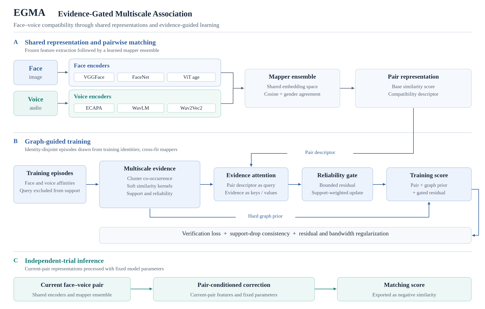

# FLAG 2027 - EGMA

Evidence-Gated Multiscale Association (EGMA) matches a face and a voice using learned pairwise similarity and gated score correction. The architecture figure shows the shared feature and matching pipeline, graph-guided training, and a proposed independent-trial inference path.

This repository contains EGMA’s architecture, training scripts, configurations, and frozen graph-based scoring code. The team’s leaderboard record shows **3.41% mean EER** for CodaBench submission **1057368**, associated with the frozen graph-based scorer.

## The Proposed EGMA Architecture



*Panel A constructs the shared pair representation. Panel B shows graph-guided learning on training episodes. Panel C illustrates the proposed independent-trial inference path.*

1. **Frozen feature extraction.** EGMA represents faces using organizer-provided VGGFace features, FaceNet features from a model trained on VGGFace2, and a ViT age representation. For voices, it combines organizer-provided ECAPA features, Microsoft WavLM Base Plus speaker embeddings, and an audEERING Wav2Vec2 age/gender representation. The public encoders remain frozen, and the release registries pin their versions and weights. These modality-specific representations feed the mapper ensemble shown in panel A.

2. **Pairwise matching.** Four trained face–voice mappers project the features into a shared 128-dimensional space. EGMA averages their cosine-based scores to form the base similarity. In the `no_gender` configuration, each mapper includes a fixed gender-posterior agreement term. The head’s six-value pair descriptor contains the base score, mean cosine similarity, mean gender-posterior agreement, mean posterior entropy for each modality, and the protocol flag. Together, the base score and descriptor form the pair representation passed to the subsequent training or inference pathway.

3. **Multiscale graph evidence.** Panel B constructs evidence within training episodes. One token represents hard cluster co-occurrence, and four tokens represent soft face–voice similarity kernels. Three kernels use FaceNet and WavLM at different bandwidths. The fourth uses VGGFace and ECAPA. The query’s exact media pair, including duplicate copies, is excluded from its support. Each token records observed support, expected support under independent face and voice affinities, their log ratio, the support degree for each modality, and a reliability measure.

4. **Gated score correction.** In the graph-guided head, the pair descriptor supplies the attention query, while the evidence tokens supply keys and values. The attended evidence and pair representation determine a bounded residual. A reliability gate scales this residual according to the available support. The graph-based score combines the base pair score, the hard-cluster log-ratio prior, and the gated residual. The graph-guided head contains **3,540 parameters**.

The graph-based EGMA head trains on episodes drawn from 56 English identities. Each fitting episode uses a cross-fit mapper trained on separate identities. The original 14 reserved identities are excluded from the head’s development and refit. The selected loss gives equal weight to verification in the `gender` and `no_gender` protocols. A support-drop consistency term encourages the residual to remain stable when supporting training edges are removed. Additional penalties discourage large residuals and large departures from the initial kernel bandwidths. The ranking loss weight is zero, and the graph-guided training head was refit for 23 epochs. No audio encoder was fine-tuned or adapted using Bengali speech.

During training, EGMA constructs graph evidence from training identities. The graph-guided head scores each pair with full and randomly reduced support, sharing parameters across both passes. The training objective combines protocol-balanced binary verification with a Smooth L1 consistency loss that encourages the reduced-support correction to match the detached full-support correction. The pair descriptor supplies the attention query, while graph evidence tokens supply the keys and values.

The training objective updates the graph-guided head directly. The frozen scorer loads that same head and feeds it graph evidence computed from the pooled evaluation trials.

## Evaluation inference

**Proposed independent-trial inference (panel C).** A single face–voice pair would pass through the frozen feature extraction and trained mapper ensemble. The correction would depend only on that pair’s features and fixed parameters learned from permitted training data. This path is a design proposal.

**Frozen graph-based inference.** The scorer for the archived submission loads the pooled, unlabeled evaluation features, clusters face and voice embeddings separately, and computes hard and soft graph evidence from other evaluation trials. The checkpoint weights stay fixed during evaluation. The scorer exports negative similarity, so lower scores indicate stronger matches. [Inference code](src/association/infer.py) · [Graph evidence](src/association/evidence.py)

## Reproduce the release

### Set up Python on macOS, Windows, or Linux

Install Miniconda for your operating system and processor. Open the shell for your platform, then change into the repository directory. [Conda installation guide](https://docs.conda.io/projects/conda/en/stable/user-guide/install/index.html)

| Platform | Shell |
| --- | --- |
| macOS on Apple Silicon | Terminal with native arm64 Miniconda |
| Windows (x86-64) | Anaconda Prompt from the Start menu |
| Linux (x86-64) | A terminal with Conda initialized |

Create and activate the environment on any of these platforms.

```bash
conda create -n flag-egma python=3.11 pip -y
conda activate flag-egma
```

On Windows and Linux, install the pinned CPU builds of PyTorch and TorchAudio before installing the rest of the dependencies. [PyTorch 2.6 installation instructions](https://pytorch.org/get-started/previous-versions/#v260)

```bash
python -m pip install torch==2.6.0 torchaudio==2.6.0 --index-url https://download.pytorch.org/whl/cpu
```

On all three platforms, install the dependencies and EGMA package from the checkout.

```bash
python -m pip install -r requirements.txt
python -m pip check
python -m flag_egma --help
```

### Verify the frozen release

Restore the authorized `data/` and `release/` bundles, the original `requirements-lock.txt`, and the release manifest at `docs/EGMA_RELEASE.json` before running the checksum check. These paths are relative to the repository root. Package installation uses `requirements.txt`.

```bash
python -m flag_egma verify
```

The supplied original `validate` and `reproduce` configurations require PyTorch MPS. Run those configurations on an Apple Silicon Mac. The Windows and Linux instructions cover package installation. On macOS, confirm that the active environment can access MPS before running validation or scoring. [PyTorch MPS documentation](https://docs.pytorch.org/docs/2.6/notes/mps.html)

```bash
python -c "import torch; print(torch.backends.mps.is_available())"
```

### English identity-holdout validation

```bash
python -m flag_egma validate --output ../egma-validation
```

The original command repeats the development procedure for the selected graph-based EGMA variant using saved identity splits, cross-fit mappers, and graph settings. It fits validation heads, prints `ARCHITECTURE SUMMARY`, and saves `summary.json` and `folds.json`. Compare `multiscale_attention.mean_english_eer_percent` in the generated summary with the archived graph-based validation result of **7.35%** in `release/validation/association/architecture_no_rank/summary.json`. The archived fold means are **9.21%**, **6.41%**, and **6.42%**.

### Evaluation submission ZIP

```bash
python -m flag_egma reproduce --output ../egma-evaluation
```

This command runs the frozen graph-based scorer with its archived head, four mappers, and verified evaluation feature pool. It writes `../egma-evaluation/submissions.zip`, four score files, and `manifest.json`, then compares the generated ZIP’s SHA-256 with the archived ZIP. Scores are generated locally without training or contacting CodaBench.

The archived submission and its **3.41% mean EER** remain associated with the scorer and configuration that generated them.
